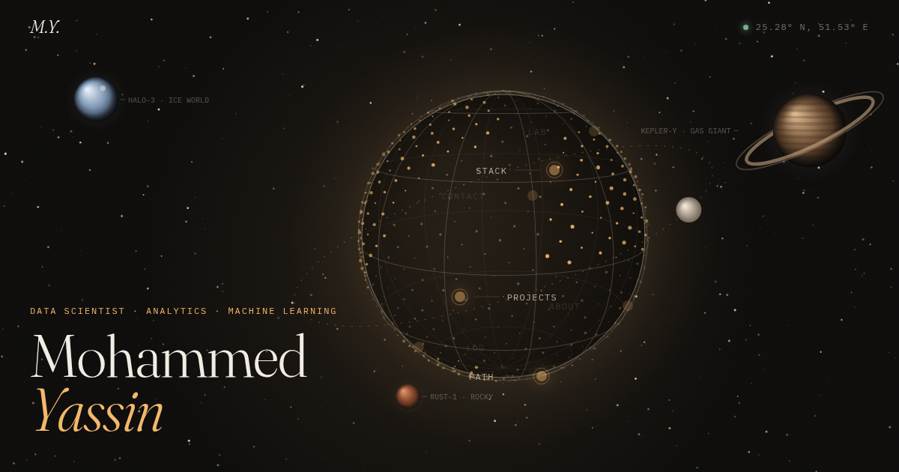

# matadining.com



Personal portfolio of **Mohammed Yassin**, data scientist based in Doha. **Live at [matadining.com](https://matadining.com).**

The name is a spoonerism: *data mining → mata dining*.

## What's in it

- **An interactive planet** drawn on a 2D canvas with a small hand-rolled 3D projection (no Three.js). It has a 900-point Fibonacci sphere, a lat/long grid, an orbiting moon, three background worlds and parallax stars. Drag to rotate, scroll or pinch to zoom.
- **Beacons on the surface** open the sections: About, Projects, Lab, Stack, Log and Contact. Clicking one warps into the planet before the panel slides in.
- **The Lab** is a live statistics demo. It simulates weekly price-vs-volume data, fits OLS by hand and runs a Student-t test on the slope (incomplete beta function, no libraries) to show when a price effect is provable and when it's just noise.
- **Themes:** five colour palettes (Amber, Nebula, Ember, Aurora, Void), each with a dark mode and a light "solar flare" mode.
- A single self-contained `index.html` with no build step, no framework and no dependencies beyond Google Fonts.

## Structure

```
public/
  index.html            the whole site: markup, styles and script
  _headers              security headers (HSTS, CSP, frame/sniff protection)
  robots.txt, sitemap.xml
  og.png                link-preview image
  favicon.svg, apple-touch-icon.png
  resume.pdf            (added separately)
wrangler.jsonc          Cloudflare Worker config: serves ./public as static assets
```

## Hosting

Served by Cloudflare Workers (static assets) on a custom domain, with Cloudflare Web Analytics for privacy-friendly, cookieless visit counts.

To deploy, connect this repo in Cloudflare → Workers & Pages → `portfolio` → Settings → Builds. Every push to `main` then redeploys the site.

## Contact

[LinkedIn](https://www.linkedin.com/in/moeyass) · [GitHub](https://github.com/Bami128) · moeyass12.8@gmail.com
